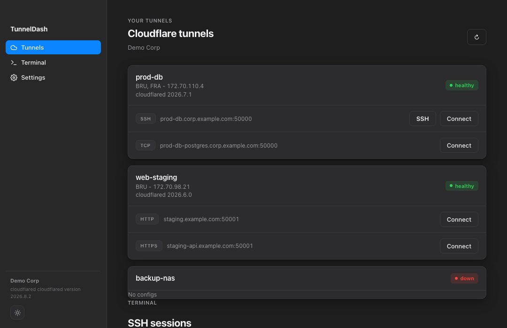

<p align="center"></p>

# TunnelDash Desktop

Discover Cloudflare Tunnel routes, start local proxies, and open SSH sessions from your desktop. TunnelDash bundles `cloudflared` and can generate OpenSSH aliases without touching entries outside its managed block.

[](https://github.com/MauroDruwel/TunnelDashDesktop/actions/workflows/ci.yml)
[](https://github.com/MauroDruwel/TunnelDashDesktop/releases/latest)
[](https://github.com/MauroDruwel/quality-gate)

| Platform | Download |
| --- | --- |
| macOS · Apple Silicon | [DMG](https://github.com/MauroDruwel/TunnelDashDesktop/releases/latest/download/TunnelDash-macos-arm64.dmg) |
| macOS · Intel | [DMG](https://github.com/MauroDruwel/TunnelDashDesktop/releases/latest/download/TunnelDash-macos-x64.dmg) |
| Windows · x64 | [MSI](https://github.com/MauroDruwel/TunnelDashDesktop/releases/latest/download/TunnelDash-windows-x64.msi) |
| Linux · x64 | [AppImage](https://github.com/MauroDruwel/TunnelDashDesktop/releases/latest/download/TunnelDash-linux-x64.AppImage) |

[All releases and CLI binaries](https://github.com/MauroDruwel/TunnelDashDesktop/releases). Linux builds target Ubuntu 24.04 and require a running Secret Service for credential storage. Installers are unsigned.



## Get connected

1. Install TunnelDash and choose a starting local port.
2. Verify a Cloudflare API token with **Account Settings: Read** and **Cloudflare Tunnel: Read**. Tunnel edit permission is optional for saving port assignments remotely.
3. Start a route proxy or open **SSH Sessions** to configure an identity and connect. Cloudflare Access policies still apply.

TunnelDash prefers a working system installation of `cloudflared` and falls
back to its bundled copy. Settings shows the selected version and source and
links to Cloudflare’s install instructions. Sync OpenSSH config again after
changing installations to refresh the executable path in existing aliases.

The token is stored in your OS credential store. Open the updated desktop app once to migrate an existing token before using `tunneldash-cli list`.

## Develop

TunnelDash checks for updates in the background on launch. You can also check
under **Settings → Software Updates**. The release page opens only when you
choose **View Release**.

Requires Node.js 22, pnpm 10, stable Rust, and the [Tauri platform prerequisites](https://v2.tauri.app/start/prerequisites/).

```sh
pnpm install --frozen-lockfile
node scripts/download-cloudflared.mjs
pnpm tauri dev
```

Run `pnpm lint`, `pnpm typecheck`, `pnpm test`, and `pnpm build`. For browser tests, run `pnpm exec playwright install chromium` once, then `pnpm test:e2e`. Run backend tests with `cargo test --manifest-path src-tauri/Cargo.toml --features cli --locked`.

CI runs Playwright against demo data, without Cloudflare credentials. Tagged releases also build and test the native code on each target before publishing. Live Cloudflare Access and SSH sessions depend on your account and policy configuration.

[Contributing](CONTRIBUTING.md) · [Changelog](CHANGELOG.md) · [MIT License](LICENSE)
